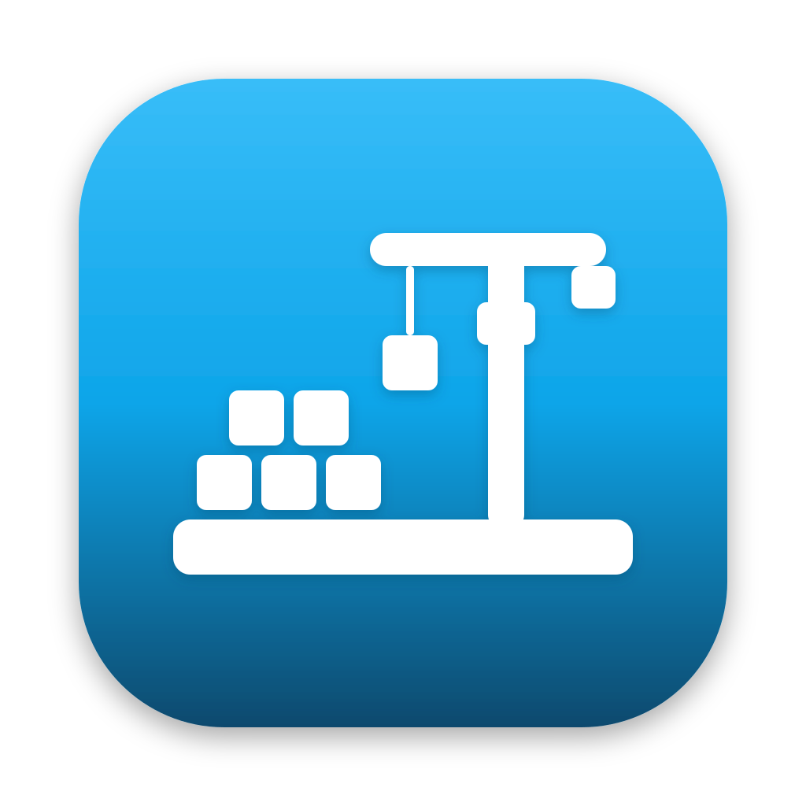

<p align="center">
  
</p>

<h1 align="center">Portwey</h1>

<p align="center">
  Play Windows games on Apple Silicon Macs.<br>
  A native macOS launcher built with Swift and SwiftUI.
</p>

<p align="center">
  <a href="https://github.com/Vympel87/Portwey/releases/latest">Download</a> ·
  <a href="#features">Features</a> ·
  <a href="#how-it-works">How it works</a> ·
  <a href="#building-from-source">Build from source</a>
</p>

<p align="center">
  
  
  
  
</p>


## What is Portwey?

Portwey runs Windows games, like the ones you buy on itch.io, on a Mac with Apple Silicon. Add a game's `.exe`, its folder or its `.zip`, and Portwey picks the best way to run it:

- **Natively**, when the game's engine has a Mac version (RPG Maker MV/MZ and Godot)
- **Through Wine**, with DirectX translated to Metal by DXVK, for everything else

Everything Portwey needs (Wine, DXVK, NW.js, Godot) is downloaded automatically on first launch. No Terminal, no Homebrew.

## Features

**Smart launching**

- Detects the game engine: Unity, Unreal, Godot, GameMaker, RPG Maker MV/MZ/VX Ace and Ren'Py
- Runs **RPG Maker MV/MZ natively** through NW.js, with a compatibility layer for older games
- Runs **Godot games natively** by reading the engine version from the game's `.pck` and downloading the matching Godot build
- Falls back to Wine for everything else

**Graphics**

- **DXVK** (DirectX 10/11 → Vulkan → Metal), per game
- **DXMT** (DirectX 11 → Metal), experimental
- **WineD3D** as a fallback

**Library**

- Add games by `.exe`, folder or `.zip`, or drag and drop
- Covers, or the game's own icon pulled from its `.exe`
- Filters, search, playtime and "recently played"
- Menu bar shortcut and Dock menu for recent games

**Control**

- Bottles (Wine environments): shared or one per game, with disk usage, reset and delete
- Multiple Wine versions: install from the list, import your own build, pick a default
- Per-game launch arguments and environment variables
- Presets: save a game's working settings and reuse them
- Live logs, with plain-language hints for common errors

**Steam (beta)**

- Installs the Windows version of Steam in its own bottle and syncs installed games into your library

## Download

Get the latest `.dmg` from **[Releases](https://github.com/Vympel87/Portwey/releases/latest)**.

Portwey isn't notarized by Apple, so the first launch needs one extra step:

1. Drag Portwey into **Applications** and open it. macOS says it can't verify the app; click **Done**.
2. Open **System Settings → Privacy & Security**, scroll down and click **Open Anyway** next to Portwey.
3. Confirm with your password and click **Open**.

You only need to do this once.

**Requirements:** a Mac with Apple Silicon (M1 or newer), macOS 14 or later, and about 2 GB of free space for Wine and its tools.

## Tested games

| Game / engine            | Runs with    | Graphics | Status                                  |
| ------------------------ | ------------ | -------- | --------------------------------------- |
| Unity, DirectX 11        | Wine         | DXVK     | ✅ Works                                |
| RPG Maker MV game (v1.6) | Native NW.js | Metal    | ✅ Works                                |
| Godot game               | Native Godot | Metal    | ✅ Works                                |
| Steam client             | Wine         | —       | ⚠️ Window stays black with stock Wine |

Tried a game? Open an issue with the result, or share its preset from the Presets page.

## How it works

```
Portwey.app (SwiftUI)
│
├── Library, detail, settings, menu bar and Dock menu
│
└── LauncherCore (Swift package, no UI)
    ├── GameEngineDetector    reads files and the .exe to find the engine
    ├── GameRunner            picks the runner and streams logs
    │   ├── Wine              + DXVK / DXMT / WineD3D, per-game bottles
    │   ├── NW.js             RPG Maker MV/MZ, with a compatibility shim
    │   └── Godot             matching engine version, --main-pack
    ├── SetupManager          Rosetta 2, Wine, DXVK on first launch
    ├── WineRuntimeService    multiple Wine versions, APFS-cloned variants
    ├── ExeIconExtractor      PE resource parser that rebuilds the .exe icon
    ├── GodotPack             reads Godot versions from .pck headers
    ├── VDFParser             reads Steam's libraryfolders.vdf and appmanifests
    └── GameLibrary / Presets JSON storage
```

A few details that took the most work:

- **Icons from `.exe` files.** A pure-Swift parser walks the PE resource tree, rebuilds an `.ico` from `RT_GROUP_ICON` and `RT_ICON` entries and turns it into a PNG.
- **Old RPG Maker games on a new NW.js.** Many plugins compare version strings as text, so `"0.119"` looks older than `"0.13"`. Portwey injects a small shim before the game's scripts that fixes this and normalizes legacy window options.
- **DXVK without touching the game folder.** Each graphics backend gets its own APFS clone of the Wine runtime with the DLLs swapped in, so variants take almost no extra space.

## Building from source

Requirements: Xcode 26 or later, macOS 14 or later, Apple Silicon.

```bash
git clone https://github.com/Vympel87/Portwey.git
cd Portwey
open Portwey.xcodeproj
```

Press **⌘R** to run. To build a release DMG:

```bash
./scripts/make-dmg.sh
```

The DMG is written to `dist/`.

## Where Portwey keeps its data

Everything lives in `~/Library/Application Support/Portwey/`: Wine versions, bottles, games imported from `.zip` files, covers and the library. To remove all of it, use **Settings → Uninstall Portwey…**, which also moves the app to the Trash.

## Known limitations

- **Anti-cheat** (EasyAntiCheat, BattlEye and similar) usually blocks games under Wine.
- **Steam** opens but its window stays black with the standard Wine builds; it needs patches found in CrossOver-based Wine.
- **DXMT** also needs a CrossOver-based Wine build to attach its Metal view.
- Wine runs through **Rosetta 2**. Future macOS versions that limit Rosetta could affect this; ARM64 Wine is on the roadmap.

## Roadmap

- [ ] Wine built from CrossOver's sources (Steam and DXMT)
- [ ] ARM64 Wine with FEX, without Rosetta
- [ ] More engines running natively
- [ ] Community preset sharing

## Credits

Portwey stands on the shoulders of these projects. They are downloaded from their official sources at runtime and keep their own licenses:

[Wine](https://www.winehq.org) ·
[macOS Wine builds by Gcenx](https://github.com/Gcenx/macOS_Wine_builds) ·
[MoltenVK](https://github.com/KhronosGroup/MoltenVK) ·
[DXVK-macOS](https://github.com/Gcenx/DXVK-macOS) ·
[DXMT](https://github.com/3Shain/dxmt) ·
[NW.js](https://nwjs.io) ·
[Godot Engine](https://godotengine.org)

Inspired by [Whisky](https://github.com/Whisky-App/Whisky) and Wingames.

Portwey isn't affiliated with or endorsed by any of these projects, Valve or Apple.

## License

Portwey is free software, released under the [GNU General Public License v3.0](LICENSE).
